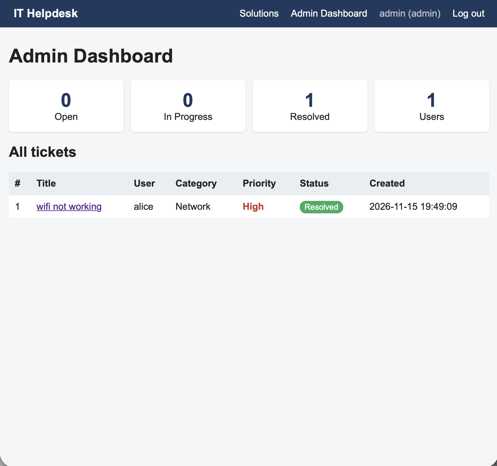
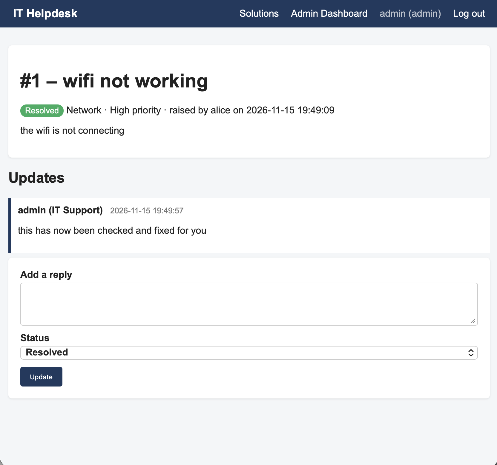
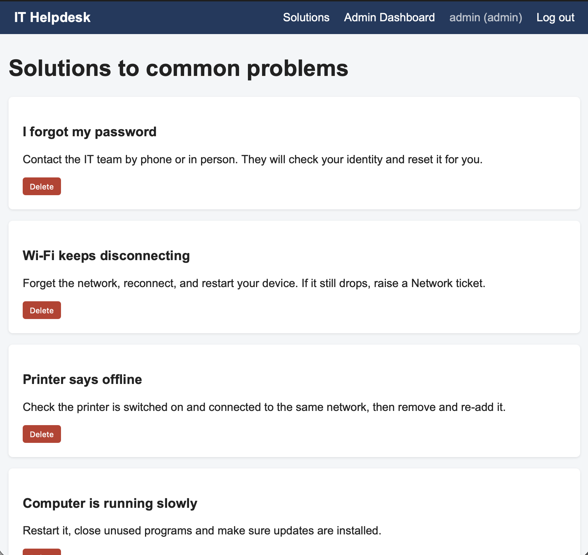

# Secure IT Helpdesk Portal

A small web app where staff can report IT issues, track their tickets and look up solutions to common problems. IT admins get a dashboard to manage every ticket.

Built with **Python (Flask)**, **SQLite**, **HTML** and **CSS**.

## Screenshots

**Admin dashboard**


**Ticket page – IT replies and resolves the issue**


**Solutions to common problems**


## Features

- **Register / log in / log out**
- **Two roles:** `user` and `admin`
- **Users** can raise tickets (title, category, priority, description), see only their own tickets, and reply to them
- **Admins** see every ticket, filter by status, reply to tickets and change their status (Open → In Progress → Resolved)
- **Admin dashboard** with ticket counts by status and number of users
- **Solutions page** (FAQ) that anyone can read and admins can add to or delete from

## Security features

| Risk | How it's handled |
|---|---|
| Stolen passwords | Passwords are hashed with PBKDF2-SHA256 using Werkzeug (`generate_password_hash`), never stored as plain text |
| SQL injection | Every query uses `?` placeholders instead of joining strings together |
| Cross-site scripting (XSS) | Jinja templates escape user input automatically |
| Cross-site request forgery (CSRF) | Every form sends a secret token that is checked on each POST request |
| Seeing other people's tickets | The server checks that a ticket belongs to the logged-in user (or that they are an admin) |
| Non-admins opening admin pages | `@admin_required` decorator returns 403 Forbidden |
| Guessing usernames | Login shows the same error for a wrong username or a wrong password |
| Session theft | Session cookie is `HttpOnly` and `SameSite=Lax`; secret key is read from an environment variable |

## How to run it

```bash
python -m venv venv
source venv/bin/activate        # Windows: venv\Scripts\activate
pip install -r requirements.txt
python app.py
```

Then open http://127.0.0.1:5001

The database (`helpdesk.db`) is created automatically the first time you run it.

**Default admin login:** username `admin`, password `Admin123!`
(Set the `ADMIN_PASSWORD` environment variable before the first run to choose your own.)

## Project structure

```
app.py            Flask routes, login logic and security checks
schema.sql        Database tables (users, tickets, comments, faqs)
templates/        HTML pages (Jinja templates)
static/style.css  Styling
```

## Database design

- **users** – id, username, password_hash, role
- **tickets** – id, user_id → users, title, description, category, priority, status, created_at
- **comments** – id, ticket_id → tickets, user_id → users, message, created_at
- **faqs** – id, question, answer

## Possible improvements

- Email notifications when a ticket is updated
- Password reset by email
- Limit failed login attempts (rate limiting)
- Assign tickets to specific IT staff
